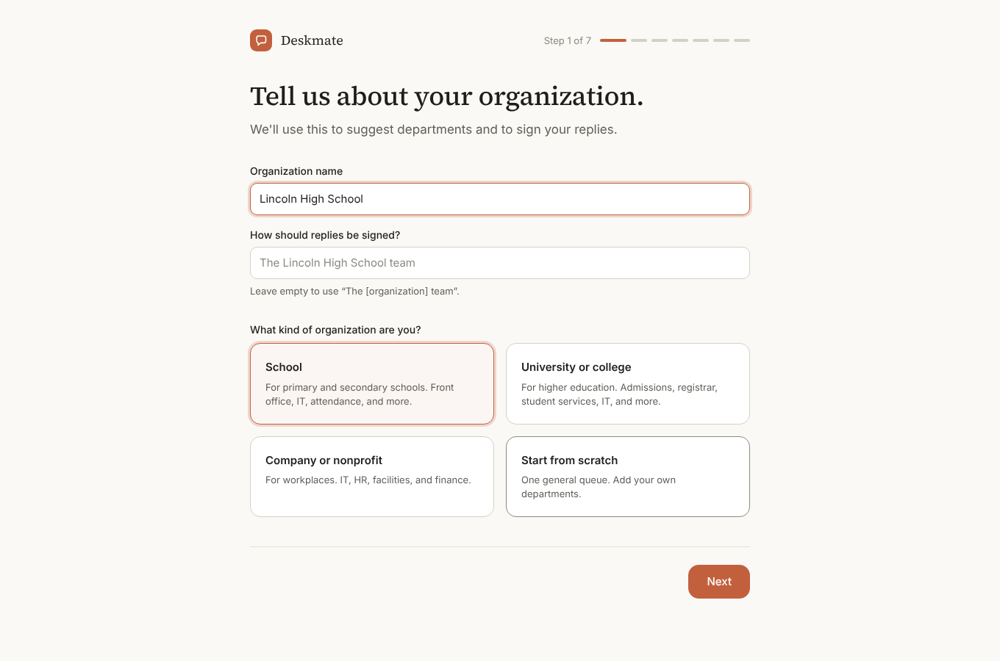
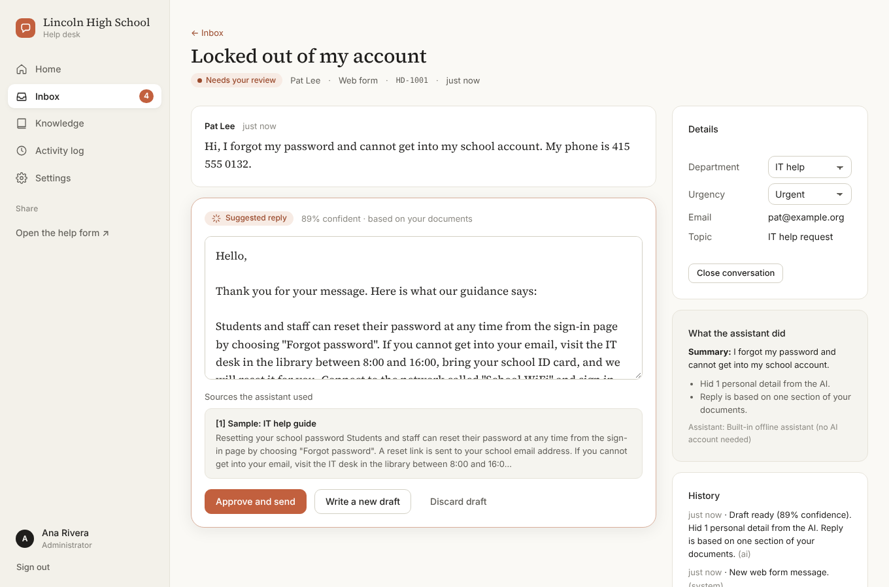
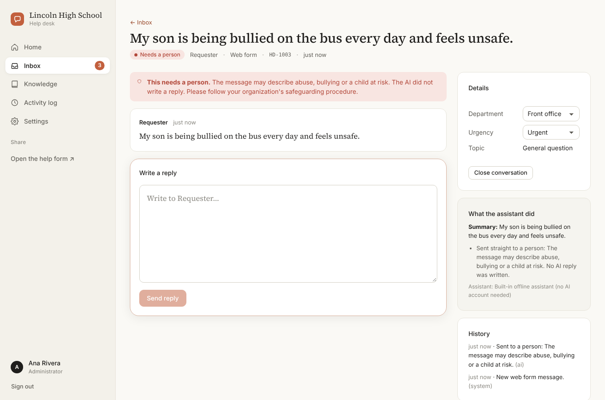

# Deskmate

**An open source AI help desk for schools, universities, and organizations, built to be set up by the people who run the front office and not only by developers.**

Deskmate collects questions from a web form, email, and text messages. It sorts each one to the right department, drafts a reply from your own documents with sources, and **waits for a person to approve it** before anything is sent.

> Status: Phase 1 MVP. It works end to end with no API keys, using the built-in offline assistant. See the [roadmap](#roadmap).

| Setup wizard | Approve an AI draft |
|---|---|
|  |  |
| **Home** | **Sensitive message, sent to a person** |
|  |  |

## Why Deskmate

- **Set up in a browser, no config files.** A guided wizard covers your organization name, departments (with School, University, and Company templates), AI choice with a *Test connection* button, channels, and drag-and-drop documents.
- **A person approves every reply by default.** Automatic replies can be switched on per department once you trust the drafts, and only for confident answers that come from your documents.
- **Answers only from your documents.** Every draft cites the handbook or policy it used. When nothing matches, it says a person will follow up and does not guess.
- **Private by design.** Emails, phone numbers, card numbers, and ID numbers are replaced with placeholders before any text reaches an AI model. You can run a fully local model with Ollama.
- **Safety first.** Messages about self-harm, abuse, violence, or emergencies skip the AI entirely and are flagged for a person.
- **Accountable.** Every AI decision and every human action is written to a plain-language activity log.
- **Bring your own model.** Built-in offline assistant (free, no account), OpenAI, Anthropic, or a local model through Ollama.

## Quick start

### For non-technical admins (one command)

You need [Docker](https://docs.docker.com/get-docker/) installed. Then, in this folder:

```sh
./install.sh
```

It starts Deskmate and prints a link like `http://localhost:3000/setup?code=ABCD-1234`. Open it and follow the wizard. The [Setup guide](docs/SETUP_GUIDE.md) walks through every screen in plain language.

> The Docker files are written but have not yet been test-built (the build environment had no Docker daemon). The Node path below is fully tested.

### With Docker Compose directly

```sh
docker compose up -d --build
docker compose logs deskmate        # shows your setup link
```

Optional private AI model on the same server:

```sh
docker compose --profile local-ai up -d
docker compose exec ollama ollama pull llama3.1
```

### For developers

Requires Node.js 22 or newer.

```sh
npm install
npm run dev          # server on :3000, web app on :5173 (open http://localhost:5173)
npm test             # core + API tests
npm run typecheck
npm run build && npm start   # production mode on :3000
```

The setup code is printed in the terminal and saved to `data/setup-code.txt`.

## How a message flows

```
 Web form / Email / SMS / WhatsApp
                │
                ▼
     1. Hide personal details        (the AI never sees them)
     2. Safety screen ──────────────► sensitive? → "Needs a person", no AI draft
     3. Sort: department, urgency, one-line summary
     4. Search your documents
     5. Draft a reply with numbered sources
                │
                ▼
     Inbox: "Needs your review"  ──►  staff edit / approve / discard
                │
                ▼
     Sent by email, SMS, WhatsApp, or shown on the requester's status page
     Everything recorded in the activity log
```

## Project layout

```
packages/core     The engine: redaction, safety screen, triage, search, drafting, model adapters, templates
apps/server       HTTP API, webhooks, storage, sending (Node, no framework)
apps/web          Setup wizard, admin console, public help form (React + Vite)
docs/             Architecture, design system, setup guide
```

Read [docs/ARCHITECTURE.md](docs/ARCHITECTURE.md) for the details and the reasoning behind them.

## Design

The interface takes **big inspiration from the Claude app by Anthropic**: its warm neutral palette, serif headings paired with a clean sans-serif, comfortable type sizes and line heights, generous spacing, and rounded, minimal components. We wanted a help desk that feels calm and readable for office staff, and the Claude app is one of the best examples of that. This is inspiration only. Deskmate uses its own colors, open-source fonts (Source Serif 4 and Inter), and its own logo, and it uses no Anthropic branding or assets. See [docs/DESIGN.md](docs/DESIGN.md).

## Roadmap

| Phase | What |
|---|---|
| **1 (this release)** | Setup wizard, inbox and approval queue, web form, outbound email, inbound email webhook, Twilio SMS and WhatsApp webhook, PII redaction, safety screen, document search, OpenAI, Anthropic, and Ollama adapters, audit log, templates |
| 2 | Postgres storage option, IMAP mailbox polling (no webhook needed), identity checks for SMS, password reset by email, per-department staff assignment, SLA reminders |
| 3 | Embeddings search (pgvector), website and Google Drive import, multilingual replies, evaluation dashboard (accuracy, deflection, time saved) |
| 4 | Voice calls through Twilio with a summary handed to a person, Zammad and FreeScout connectors, one-click cloud deploy buttons |

## Contributing

See [CONTRIBUTING.md](CONTRIBUTING.md). Security reports: see [SECURITY.md](SECURITY.md).

## License

[Apache License 2.0](LICENSE)
