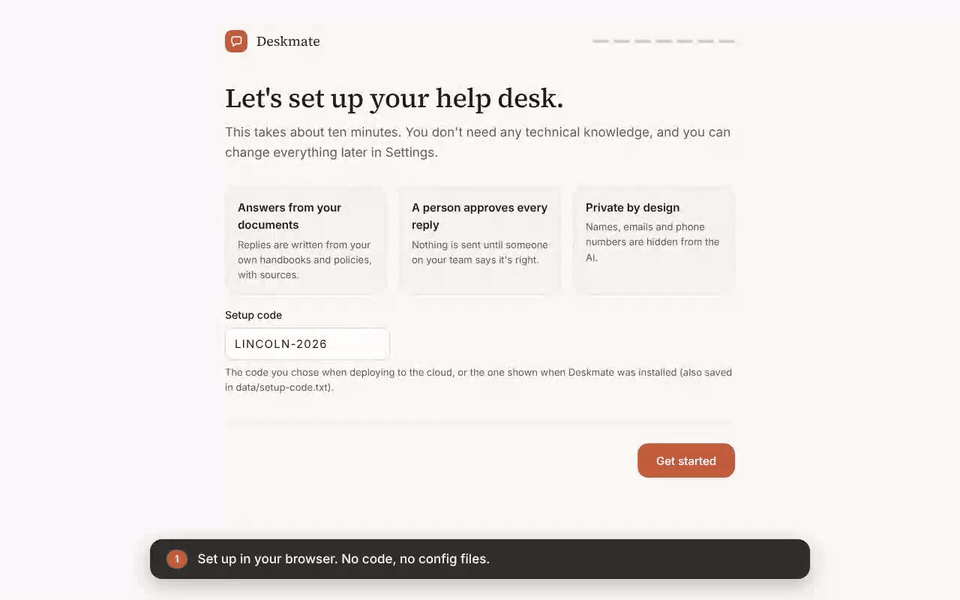
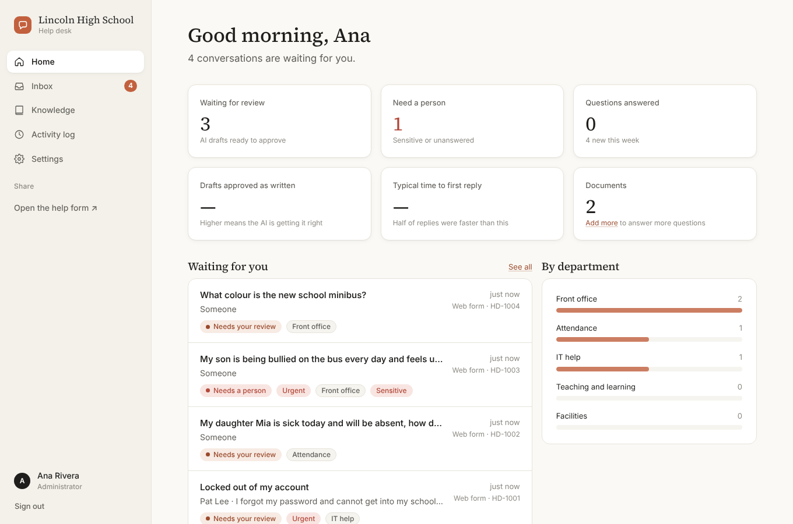

<div align="center">


# Deskmate

**The open source AI help desk that a school office can set up by itself.**

Questions come in by web form, email, SMS or WhatsApp. Deskmate sorts them, drafts answers from *your own* documents with sources, and **waits for a person to approve every reply**.

[](https://github.com/YOUR-GITHUB-NAME/deskmate/actions/workflows/ci.yml)
[](LICENSE)
[](#bring-your-own-ai)
[](CONTRIBUTING.md)

[**Try it**](#get-started-in-minutes) · [**Watch the 3-minute tour**](docs/media/walkthrough.mp4) · [**How it works**](#how-it-works) · [**Docs**](docs/)



</div>

---

## Why Deskmate?

Front offices, IT desks and registrars answer the same questions every day: *How do I reset my password? Has the bus stop changed? When does term start?* AI can help, but most AI help desks are built for tech companies. They need developers to set up, they send student data to whoever hosts them, and they reply to people with nobody checking.

Deskmate is built the other way round:

| | |
|---|---|
| 🧑‍🏫 **Set up by office staff** | A friendly setup wizard in the browser, with templates for schools, universities and companies. You paste a key and press *Test connection*. No config files. |
| ✅ **A person approves every reply** | AI drafts wait in an inbox. Staff approve with one click, edit, or write their own. You can turn on automatic replies per department, and only once you trust them. |
| 📚 **Answers only from your documents** | Drop in handbooks and policies. Every draft cites its source. When the answer isn't there, it says a person will follow up and doesn't guess. |
| 🔒 **Private by design** | Names, emails, phone numbers and ID numbers are hidden *before* anything reaches an AI. You can run a fully local model so nothing leaves your building. |
| 🛟 **Safeguarding first** | Messages about self-harm, abuse, threats or emergencies skip the AI completely and are flagged urgent for a person. |
| 🧾 **Accountable** | Every AI decision and every human action is recorded in a plain-language activity log. |

## Get started in minutes

Pick whichever suits you. **None of them need an AI account**, because the built-in assistant works offline for free.

| | Best for | How |
|---|---|---|
| 💻 **Desktop app** | Trying it out, or one office | Download from [Releases](https://github.com/YOUR-GITHUB-NAME/deskmate/releases) and double-click it. [Guide](docs/DESKTOP.md) |
| ☁️ **One-click cloud** | A public help form, SMS and email | [](https://render.com/deploy?repo=https://github.com/YOUR-GITHUB-NAME/deskmate) Also works on Railway and Fly.io. [Guide](docs/DEPLOY.md) |
| 🖥️ **Your own server** | IT teams, strict data rules | `./install.sh` (Docker). [Guide](docs/SETUP_GUIDE.md) |

Then open the link it gives you and follow the wizard. That's it.

<details>
<summary><b>Docker Compose and local AI details</b></summary>

```sh
docker compose up -d --build
docker compose logs deskmate                 # shows your setup link

# Optional: a private AI model on the same server
docker compose --profile local-ai up -d
docker compose exec ollama ollama pull llama3.1
# then choose "Private model on your own server" with address http://ollama:11434
```
</details>

## How it works

```
  Web form · Email · SMS · WhatsApp
                 │
                 ▼
   ① Hide personal details ............ the AI never sees them
   ② Safety screen ─────────────────▶ sensitive → "Needs a person", no AI draft
   ③ Sort by department and urgency
   ④ Search your documents
   ⑤ Draft a reply with numbered sources
                 │
                 ▼
   Inbox: "Needs your review" ──▶ approve · edit · discard
                 │
                 ▼
   Delivered by email, SMS, WhatsApp, or on the requester's private status page.
   Everything is recorded in the activity log.
```

<table>
<tr>
<td width="50%"><br/><sub><b>Approve a draft.</b> Sources are shown, and the parent's phone number was hidden from the AI.</sub></td>
<td width="50%"><br/><sub><b>Safeguarding.</b> No AI reply is written. A person handles it.</sub></td>
</tr>
<tr>
<td><br/><sub><b>Setup wizard.</b> Templates, departments, AI, channels, documents.</sub></td>
<td><br/><sub><b>Home.</b> What's waiting, in plain language, plus how often drafts were approved as written.</sub></td>
</tr>
</table>

## Bring your own AI

| Option | Cost | Data leaves your network? |
|---|---|---|
| Built-in assistant (sorts by keywords, quotes your documents) | Free | No |
| Private model via [Ollama](https://ollama.com) | Free (your hardware) | No |
| OpenAI | Pay per use | Yes, with personal details already hidden |
| Anthropic Claude | Pay per use | Yes, with personal details already hidden |

You can switch at any time in Settings. Adding another provider takes about 60 lines ([how](docs/ARCHITECTURE.md#extending)).

## Features

- **Setup wizard** with School, University, Company and blank templates, editable departments, and a *Test connection* button for the AI, email and Twilio
- **Inbox** with filters, search, urgency, and "Needs your review" and "Needs a person" queues
- **Draft review** with sources, confidence, a note on what the AI did, and one-click approve, edit, regenerate or discard
- **Knowledge library** where you drag and drop PDFs, text, Markdown or web pages, or paste text, then *check what the assistant would find*
- **Channels:** public help form with a private status page, email replies (SMTP), inbound email webhook, and Twilio SMS and WhatsApp with signature verification
- **Automatic replies per department**, optional and limited to confident, sourced, non-sensitive answers
- **Team** roles (admin and staff), temporary passwords, password changes and resets
- **Activity log** of every AI and human action, and **backup download**
- **Security:** one-time setup code, encrypted secrets, scrypt passwords, CSRF protection, rate limits, and a bot honeypot
- **Light and dark mode**, and a layout that works on a phone

## FAQ

<details><summary><b>Do we need an OpenAI or Anthropic account?</b></summary>
No. The built-in assistant works offline and free. It quotes the most relevant parts of your documents. Hosted models write more natural replies, and you can switch whenever you like.
</details>

<details><summary><b>Is student data sent to AI companies?</b></summary>
Only if you choose a hosted model, and even then personal details (emails, phone numbers, ID and card numbers) are replaced with placeholders first. With the built-in assistant or a local model, nothing leaves your server. Sensitive messages never go to any AI.
</details>

<details><summary><b>Will it reply to people on its own?</b></summary>
Not unless you turn that on, per department. Even then it only sends answers that come from your documents, are above your confidence threshold, and aren't sensitive. Everything else waits for a person.
</details>

<details><summary><b>We already use Zammad, FreeScout or osTicket.</b></summary>
Connectors are on the roadmap. Deskmate's built-in inbox exists so small organizations don't need a second product, but the engine (<code>packages/core</code>) is designed to sit on top of other ticketing tools too.
</details>

<details><summary><b>Where is our data stored?</b></summary>
In one file on your own computer, server or cloud disk. Back it up by copying that folder, or use <i>Settings → Privacy and safety → Download a backup</i>.
</details>

## Roadmap

- [x] **0.1:** setup wizard, approval inbox, grounded drafting, redaction, safety screen, web form, email, SMS and WhatsApp, desktop app, one-click deploy
- [ ] **0.2:** Postgres option, IMAP mailbox polling, password reset by email, staff assignment and SLA reminders, translations of the interface
- [ ] **0.3:** embeddings search (pgvector), website and Google Drive import, multilingual replies, evaluation dashboard (accuracy, time saved)
- [ ] **0.4:** voice calls with a summary handed to a person, Zammad and FreeScout connectors, signed installers

Have a need that isn't here? [Open an issue](https://github.com/YOUR-GITHUB-NAME/deskmate/issues/new/choose). We especially want to hear from schools.

## Contributing

Deskmate welcomes contributors who aren't developers too: translations, templates for your kind of organization, documentation, and reports of anything confusing. Start with [CONTRIBUTING.md](CONTRIBUTING.md).

```sh
npm install && npm run dev      # API on :3000, web app on :5173
npm test && npm run typecheck
```

```
packages/core   engine: redaction, safety, triage, search, drafting, model adapters, templates
apps/server     HTTP API, webhooks, storage, sending (Node, no framework)
apps/web        setup wizard, console, public help form (React + Vite)
apps/desktop    desktop app (Electron)
```

Architecture and design decisions: [docs/ARCHITECTURE.md](docs/ARCHITECTURE.md). Security: [SECURITY.md](SECURITY.md).

## Design and acknowledgements

The interface takes **big inspiration from the [Claude](https://claude.ai) app by Anthropic**: its warm neutral palette, serif headings with a clean sans-serif, comfortable type sizes, generous spacing, and rounded, minimal components. We wanted a help desk that feels calm for people who use it all day. This is inspiration only. Deskmate has its own colors, open-source fonts (Source Serif 4 and Inter), and its own logo, and it isn't affiliated with Anthropic. See [docs/DESIGN.md](docs/DESIGN.md).

The idea grew from a hackathon project that routed Twilio calls to AI agents, reworked here for the real-world needs of schools: privacy, safeguarding, accountability, and setup without developers.

## License

[Apache License 2.0](LICENSE). Free to use, change and share, including commercially.
